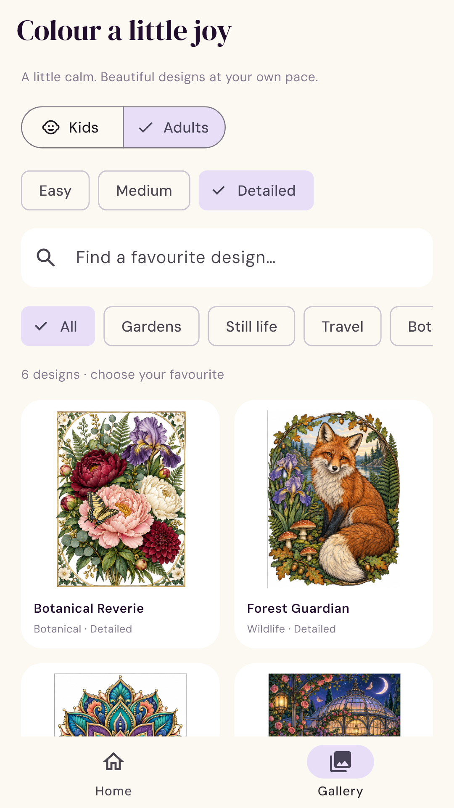

# Sketluma — Sketch & Paint

**0.6.2+10 test candidate:** company package `com.epitomehub.sketluma`, with Sketluma / Powered by EpitomeHub® branding. This package installs separately from the older personal-package test app. See [package migration notes](docs/RELEASE_0_6_2.md). The drawing tools, saved snapshot animation and Google demo ads remain available; live monetization is not enabled.

Previous candidate **0.5.0+7** added eight illustrated colouring scenes and on-demand artwork loading, background mask preparation, memory-pressure cleanup and local diagnostics. See [actual content count, source resolution, signing and remaining Play steps](docs/RELEASE_0_5.md). The current build remains an internal testing candidate, not a completed 2,000-artwork production release.

Version 0.3.0 replaces the visible colouring library with six approved detailed
artworks, expandable colour references, tap-to-fill, brush painting, persisted
progress and completion applause. See [premium beta scope and device checks](docs/PREMIUM_BETA.md).
The earlier 2,000 procedural variants remain supported for legacy saves only.



[Colouring screen preview](docs/play-store/sketluma-v1/screen-04-colouring.png)

Flutter drawing app for Android and iOS. Phase 1 is an offline testing preview
with the approved S logo, warm ivory surfaces, violet controls and coral accents.

## Phase 1 features

- Home, recent sketch, gallery, portrait/square/landscape canvases.
- Pen, pencil, translucent marker, layer-aware eraser, size and opacity.
- Colour swatches and HSV mixer; supported stylus pressure.
- Single-pointer drawing, two-pointer pan/zoom, hand tool, fit-to-view.
- Up to 12 layers: visibility, ordering, opacity and undoable deletion.
- 60-step session undo/redo, including layer changes and clear.
- Local autosave, lifecycle save, queued writes and previous-save recovery.
- Editable reopen, rename, duplicate and confirmed deletion.
- Full-resolution white/transparent PNG through the system share/save sheet.
- Responsive phone/tablet UI and Android/iOS launcher icons.

No accounts or runtime AI services. Google demo ads are included; drawing works offline. Artwork is stored in the app support
directory; iOS OS-level backup policies may apply. Uninstalling can remove work.
Export important sketches first. Undo history is session-only.

## Run and verify

Developed with Flutter 3.47.4 / Dart 3.13.3. Android SDK 36 and JDK 17+ required.

```sh
flutter pub get
flutter run
flutter analyze
flutter test
flutter build apk --debug
```

App ID: `com.epitomehub.sketluma` (new company package; separate install). Version: `0.6.2+10`.
Current project minimums: Android 7.0 (API 24), iOS 15.0.
Machine SDK paths live in ignored `android/local.properties`.
Use `scripts/verify.ps1` for Windows checks and APK packaging. It also directs
Java's temporary sockets into the workspace to avoid the packaged Windows shell
AF_UNIX path issue, as described by [OpenJDK](https://mail.openjdk.org/pipermail/nio-dev/2023-March/013297.html).

## iOS / Mac handoff

On a Mac with Xcode and command-line tools installed:

```sh
flutter pub get
flutter build ios --simulator --debug
flutter devices
flutter run -d <simulator-or-device-id>
```

For a device, open `ios/Runner.xcworkspace`, set Runner > Signing & Capabilities
to your Apple team, and select the device. For TestFlight, configure distribution
signing, run `flutter build ipa`, and upload with Xcode/Transporter.
iOS build, signing, Apple Pencil and iPad share sheets need Mac/device validation.
Windows checks do not establish iOS readiness. Distribution keys are not included.
Android release currently uses debug signing for internal tests; configure your
own signing before store submission.

## Testing / next phases

See [testing checklist](docs/PHASES_AND_TESTING.md) and
[verification results](docs/VERIFICATION.md). Screenshot tests use an editable
botanical vector fixture; the installed app starts with an empty gallery.

Phase 2: import, selection, transforms, canvas rotation, eyedropper,
textured brushes, project backup/import and device performance tuning.
Phase 3: optional AI refinement/colouring with original-preserving result layers.

## Assets

Approved logo and icon: `assets/branding/`. Generation prompts are stored beside
them. DM Serif Display and DM Sans are bundled for offline typography under the
SIL Open Font License (`assets/fonts/OFL.txt`, `assets/fonts/DMSans-OFL.txt`),
sourced from Google Fonts.
Regenerate launcher icons with `dart run flutter_launcher_icons`.
